# HipMRI Prostate Segmentation: 2D U-Net versus Context Aggregation Networks

COMP3710 Pattern Recognition — 2D CAN, Normal Difficulty  
Project folder: `recognition/2D_CAN_s4801322/`  
Task: Six-class, slice-wise segmentation of 2D HipMRI scans, focusing on prostate segmentation accuracy.

## 1. Problem, Motivation and Scope

Accurate pelvic MRI segmentation is important for preparing anatomical contours used in prostate radiotherapy planning. The prostate lies close to other organs, including the bladder and rectum, so small errors at tissue boundaries may matter even when a segmentation achieves a high overall Dice score. This project investigates whether a 2D Context Aggregation Network (CAN), which uses dilated convolutions to collect spatial context at different scales, produces more useful prostate segmentations than a standard 2D U-Net baseline. The engineering question is not only which model achieves the highest overlap score, but whether any improvement in prostate boundary quality justifies the extra parameters, GPU memory, training time and inference latency.

The implementation segments each MRI slice into six mutually exclusive classes. The primary model is 2D CAN (Normal difficulty); a 2D U-Net provides the baseline. Three CAN channel widths are investigated to study model capacity.

### Research questions and success criteria

1. Achieve test prostate Dice ≥ 0.75 for the baseline and CAN models.
2. Compare per-class Dice and IoU, with particular attention to prostate and adjacent anatomical structures.
3. Evaluate prostate boundary precision, recall and F1 using a stated spatial tolerance, and inspect 3–5 difficult boundary cases.
4. Quantify the trade-offs using trainable parameter counts, peak GPU memory, total training time, and model-only inference latency per 2D slice.
5. Recommend an architecture suitable for a resource-constrained contour-drafting workflow, with limitations stated explicitly.

## 2. Dataset and Preprocessing

### Dataset and splits

The project uses the preprocessed HipMRI Study 2D `keras_slices_data` NIfTI slices provided by COMP3710 on rangpur. The dataset folders are read as pre-existing training, validation and test splits:

| Split | MRI slices | Usage |
|---|---:|---|
| Training | 11,460 | Update model weights |
| Validation | 660 | Monitor generalisation and select checkpoints |
| Test | 540 | Final evaluation |
| Total | 12,660 | |

 The supplied dataset ensures patient data independence for each split by having different cases for each split. The training split includes cases 4 to 35 excluding case 34,
 the validate split includes cases 36 to 39 and the test split includes cases 40, 41 and 42.

### Label mapping

| Class ID | Anatomy |
|---:|---|
| 0 | Background |
| 1 | Body outline |
| 2 | Bone |
| 3 | Bladder |
| 4 | Rectum |
| 5 | Prostate |

The dataset loader pairs `case_*.nii.gz` inputs with corresponding `seg_*.nii.gz` masks using their case, week and slice numbers. Missing pairs raise an error.

### Preprocessing pipeline

1. Read each NIfTI MRI/mask using NiBabel; remove a trailing dimension when present.
2. Convert each MRI slice to `float32`; apply per-slice z-score normalisation, `(image − mean) / (standard deviation + 1e-8)`.
3. Centrally pad the normalised MRI and integer-label mask to 256 × 144 pixels (the largest image size in the dataset). MRI padding is zero after normalisation; mask padding is class 0.
4. Map the raw mask labels to indices `0–5` and convert masks to `torch.long`. The image tensor has shape `[1, 256, 144]`; its mask has shape `[256, 144]`.
5. Construct PyTorch data loaders with shuffled training batches and unshuffled validation/test batches.

No data augmentation is implemented in `dataset.py`; this is a potential improvement and a limitation.

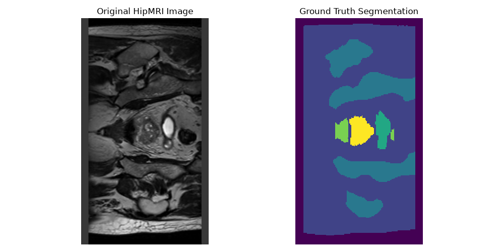  

## 3. Models and Working Principles

### 3.1 Standard 2D U-Net baseline

The baseline is a three-downsampling-stage encoder–decoder U-Net implemented in `modules.py`. Each stage uses two 3 × 3 convolutions with batch normalisation and ReLU. The encoder uses 2 × 2 max pooling to reduce spatial dimensions, while doubling feature width from 32 to 64 to 128 to 256. The decoder uses bilinear interpolation, concatenates the corresponding encoder feature map via a skip connection, and applies a double-convolution block. A final 1 × 1 convolution produces six class logits per pixel. Skip connections recover local spatial information while the deeper layers capture broader anatomical context.

```text
MRI (1 channel)
  → DoubleConv(32) ───────────────────────────────┐
  → Pool → DoubleConv(64) ──────────────────┐      │
  → Pool → DoubleConv(128) ──────────┐      │      │
  → Pool → DoubleConv(256)           │      │      │
  → Upsample + skip(128) → Conv(128) ┘      │      │
  → Upsample + skip(64)  → Conv(64)  ────────┘      │
  → Upsample + skip(32)  → Conv(32)  ──────────────┘
  → 1×1 convolution → 6-class logits
```

This is a standard U-Net with skip connections.

### 3.2 2D Context Aggregation Network (CAN)

The CAN implementation contains a two-convolution feature-extraction front end, followed by seven 3 × 3 context convolutions with dilation factors (1, 1, 2, 4, 8, 16, 1). Each convolution is followed by batch normalisation and ReLU. Appropriate padding maintains the spatial image resolution throughout. The dilation schedule makes the context stack's theoretical receptive field 67 × 67 pixels, without pooling or U-Net-style skip connections. A final 1 × 1 convolution outputs six class logits. This is a simplified CAN adaptation built around the dilated context module in the paper, MULTI-SCALE CONTEXT AGGREGATION BY
DILATED CONVOLUTIONS (F. Yu and V. Koltun, 2016).

```text
MRI (1 channel)
  → Conv 3×3 + BN + ReLU
  → Conv 3×3 + BN + ReLU
  → Dilated Conv 3×3 + BN + ReLU, dilation 1
  → Dilated Conv 3×3 + BN + ReLU, dilation 1
  → Dilated Conv 3×3 + BN + ReLU, dilation 2
  → Dilated Conv 3×3 + BN + ReLU, dilation 4
  → Dilated Conv 3×3 + BN + ReLU, dilation 8
  → Dilated Conv 3×3 + BN + ReLU, dilation 16
  → Dilated Conv 3×3 + BN + ReLU, dilation 1
  → 1×1 convolution → 6-class logits
```

The experiment varies the constant feature width of this network between 32, 64 and 128 hidden channels, retaining the same layers and dilation factors. The architectures differ in parameter count, which is measured as part of the efficiency comparison rather than artificially matched.

### 3.3 Why compare these approaches?

U-Net integrates coarse anatomical context with detailed high-resolution features through downsampling and skip connections. CAN aggregates increasingly distant spatial information at a fixed resolution with dilated convolutions. This tests whether preserving full-resolution features throughout the network is beneficial for smaller anatomical targets, and whether any improvement is worth additional computational cost.

## 4. Training and Experiment Design

The models used the same dataset directories, loss, optimizer, epoch count, seed and batch size of 16. The major independent variable among CAN runs was the number of hidden feature channels.

| Setting | Value |
|---|---|
| Input/output | One MRI channel; six segmentation classes |
| Epochs | 20 |
| Batch size | 16 for all four models |
| Optimizer | Adam |
| Learning rate | `0.0001` |
| Loss | Unweighted `CrossEntropyLoss` |
| Random seed | `4801322` |
| Image size | `256 × 144` |
| Checkpoint selection | Lowest validation cross-entropy loss |
| Training data order | Shuffled each epoch |
| Models | U-Net-32; CAN-BN-32; CAN-BN-64; CAN-BN-128 |

Cross-entropy is applied to the six raw logit channels and the integer-valued reference mask. Per-class Dice is calculated independently from `argmax` predictions; it is not part of the optimisation loss. The checkpoint chosen for test evaluation is the epoch with the lowest validation cross-entropy, which is not necessarily the epoch with the best prostate Dice.

### 4.1 Training and validation curves

Training loss fell sharply during the first few epochs for each model, while validation loss plateaued after the early training period. A persistent train–validation loss gap suggests some degree of overfitting or generalisation limitation, especially as model width grows. In CAN-128, validation loss fluctuated more noticeably despite continued reductions in training loss; this is consistent with diminishing returns from adding capacity, although these curves alone do not establish the cause.

| U-Net, 32 base channels | CAN + BN, 32 hidden channels |
|---|---|
| 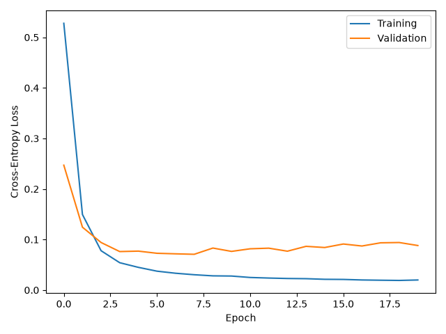 | 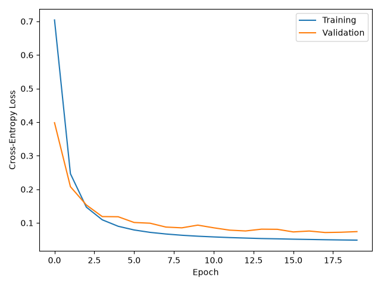 |

| CAN + BN, 64 hidden channels | CAN + BN, 128 hidden channels |
|---|---|
| 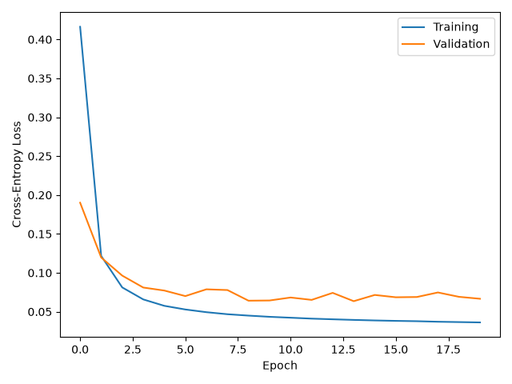 | 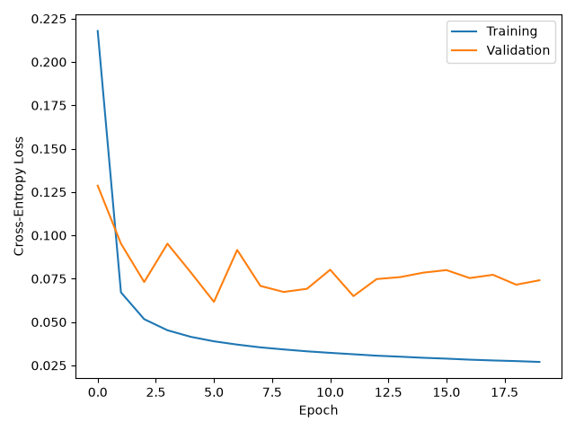 |

*Figure 1–4: Cross-entropy training and validation loss over 20 epochs.*

## 5. Evaluation Methodology

### 5.1 Region-overlap metrics

The held-out 540-slice test split is evaluated using the saved best-validation-loss checkpoint. For each class, predictions are converted from logits to class indices with `argmax`. Intersections and pixel counts are aggregated across the entire test set before calculating:

- Dice: `2 × |prediction ∩ ground truth| / (|prediction| + |ground truth|)`.
- IoU: `|prediction ∩ ground truth| / |prediction ∪ ground truth|`.
- Mean foreground Dice: Arithmetic mean of Dice for classes 1–5, excluding background.

These are test-set aggregated pixel-overlap scores, not averages of patient-level Dice scores. The primary target metric is class 5 (prostate).

### 5.2 Prostate boundary metrics

For a binary prostate mask, boundary pixels are extracted by subtracting the eroded region from the original region. Boundary precision measures the fraction of predicted contour pixels within two pixels of the ground-truth contour; recall measures the reverse; boundary F1 is their harmonic mean. The implementation averages per-slice results while ignoring slices where neither mask contains the measured class.

Boundary precision, recall, and F1 are each averaged over eligible 2D slices with `np.nanmean`.

### 5.3 Computational profiling

- Trainable parameters: Sum of the elements of all tensors with `requires_grad=True`.
- Training time: Wall-clock duration printed by `train.py` for the 20-epoch training process; includes setup/loading around the timed section.
- Training peak VRAM: Maximum CUDA allocated memory measured in `train.py`.
- Inference peak VRAM: Maximum CUDA allocated memory during the test prediction pass, after the model is loaded.
- Per-slice inference latency: Warm up with five passes, then time a batch-size-one model forward pass for each test slice with CUDA synchronization. Times exclude NIfTI loading, preprocessing and CPU to GPU transfer. Report mean, median and 95th-percentile times in milliseconds.

## 6. Results: Region Accuracy

### 6.1 Main comparison

| Model | Prostate Dice | Prostate IoU | Mean foreground Dice | Meets 0.75 target |
|---|---:|---:|---:|:---:|
| U-Net-32 | 0.8495 | 0.7384 | 0.9164 | Yes |
| CAN-BN-32 | 0.8157 | 0.6888 | 0.8950 | Yes |
| CAN-BN-64 | 0.8355 | 0.7174 | 0.9060 | Yes |
| CAN-BN-128 | 0.8479 | 0.7360 | 0.9086 | Yes |

All models meet the 0.75 prostate Dice target. The U-Net has the highest measured prostate Dice (0.8495). Widening CAN improves prostate Dice from 0.8157 at 32 channels to 0.8479 at 128 channels, leaving a gap of only 0.0016 Dice to U-Net. This indicates that CAN performance is sensitive to channel capacity, although the gain must be weighed against runtime and memory cost. These observations are from one time training results.

### 6.2 Prostate boundary quality alongside overlap

| Model | Prostate Dice | Boundary precision | Boundary recall | Boundary F1 |
|---|---:|---:|---:|---:|
| U-Net-32 | 0.8495 | 0.7496 | 0.6829 | 0.7084 |
| CAN-BN-32 | 0.8157 | 0.6413 | 0.6518 | 0.6392 |
| CAN-BN-64 | 0.8355 | 0.6643 | 0.6727 | 0.6601 |
| CAN-BN-128 | 0.8479 | 0.7120 | 0.6861 | 0.6886 |

These boundary measures are means of per-slice results with a two-pixel tolerance. In particular, CAN-128 nearly matches U-Net on region overlap but does not match its boundary F1, showing the importance of analysing contours separately from aggregate Dice.

### 6.3 Per-class Dice on the test set

| Class | Anatomy | U-Net-32 | CAN-32 | CAN-64 | CAN-128 |
|---:|---|---:|---:|---:|---:|
| 0 | Background | 0.9982 | 0.9978 | 0.9980 | 0.9978 |
| 1 | Body outline | 0.9847 | 0.9822 | 0.9834 | 0.9837 |
| 2 | Bone | 0.9361 | 0.9283 | 0.9321 | 0.9336 |
| 3 | Bladder | 0.9650 | 0.9584 | 0.9633 | 0.9618 |
| 4 | Rectum | 0.8465 | 0.7906 | 0.8155 | 0.8162 |
| 5 | Prostate | 0.8495 | 0.8157 | 0.8355 | 0.8479 |

### 6.4 Per-class IoU on the test set

| Class | Anatomy | U-Net-32 | CAN-32 | CAN-64 | CAN-128 |
|---:|---|---:|---:|---:|---:|
| 0 | Background | 0.9964 | 0.9956 | 0.9960 | 0.9956 |
| 1 | Body outline | 0.9699 | 0.9650 | 0.9673 | 0.9679 |
| 2 | Bone | 0.8799 | 0.8661 | 0.8729 | 0.8754 |
| 3 | Bladder | 0.9323 | 0.9202 | 0.9292 | 0.9264 |
| 4 | Rectum | 0.7339 | 0.6537 | 0.6884 | 0.6895 |
| 5 | Prostate | 0.7384 | 0.6888 | 0.7174 | 0.7360 |

The body outline and background achieve the strongest Dice values across all models. The rectum and prostate are notably harder, consistent with their smaller area and challenging boundaries. In this dataset the prostate accounts for 60,035 ground-truth pixels in the test split, compared with 12,083,597 body-outline pixels, illustrating the severe class imbalance. The models used unweighted cross-entropy despite this imbalance.

### 6.5 Prostate boundary precision, recall and F1

| Metric (2-pixel tolerance) | U-Net-32 | CAN-32 | CAN-64 | CAN-128 |
|---|---:|---:|---:|---:|
| Prostate boundary precision | 0.7496 | 0.6413 | 0.6643 | 0.7120 |
| Prostate boundary recall | 0.6829 | 0.6518 | 0.6727 | 0.6861 |
| Prostate boundary F1 | 0.7084 | 0.6392 | 0.6601 | 0.6886 |

U-Net-32 has the highest average prostate boundary F1 (0.7084) and boundary precision (0.7496). CAN-128 is the strongest CAN variant on prostate boundary F1 (0.6886), but remains 0.0198 lower than U-Net, even though its aggregate prostate Dice is only 0.0016 lower. CAN-128 has slightly higher mean boundary recall than U-Net (0.6861 versus 0.6829), indicating a slight precision–recall trade-off rather than a uniform improvement. From CAN-32 to CAN-128, mean boundary F1 rises by 0.0494, while computational requirements grow substantially.

## 7. Results: Computational Efficiency

| Metric | U-Net-32 | CAN-BN-32 | CAN-BN-64 | CAN-BN-128 |
|---|---:|---:|---:|---:|
| Trainable parameters | 1,949,286 | 75,078 | 297,606 | 1,185,030 |
| Training time (s) | 1,570.46 | 1,195.64 | 2,521.01 | 6,705.68 |
| Peak training VRAM (MiB) | 1,852.89 | 1,467.79 | 2,912.47 | 5,809.09 |
| Peak inference VRAM (MiB) | 552.78 | 304.41 | 594.20 | 1,177.38 |
| Mean inference (ms/slice) | 2.62 | 1.60 | 3.30 | 8.96 |
| Median inference (ms/slice) | 2.54 | 1.57 | 3.20 | 8.76 |
| p95 inference (ms/slice) | 3.09 | 1.92 | 3.98 | 10.05 |

CAN-32 uses approximately 26× fewer trainable parameters than U-Net and has lower mean model-only latency (1.60ms versus 2.62ms per slice), but sacrifices 0.0338 prostate Dice and 0.0692 prostate boundary F1. CAN-128 comes within 0.0016 Dice of U-Net while using about 61% as many parameters; however, it is approximately 3.42× slower at single-slice inference (8.96ms versus 2.62ms) and uses approximately 3.13× the peak training VRAM. This shows why parameter count alone does not predict inference cost: CAN performs several wide dilated convolutions at full spatial resolution.

CAN-64 offers an intermediate accuracy/capacity choice, but its measured single-slice latency (3.30 ms) is slower than U-Net (2.62 ms), despite its much smaller parameter count. CAN-128's prostate boundary F1 (0.6886) is also below U-Net's (0.7084), so the additional CAN capacity does not demonstrate a contour-quality advantage in this test.

## 8. Qualitative Failure Case Analysis

To investigate segmentation failures, the three test slices with the lowest prostate Dice scores from the CAN-128 model were selected. These correspond to test slices 8, 93 and 130, each achieving a prostate Dice score of 0 for CAN-128. The same slices were subsequently evaluated using the baseline U-Net to provide a direct qualitative comparison.

The prostate corresponds to class 5, represented by the small cyan region in the segmentation images. The larger pink region represents the bladder (class 3). This distinction is important because the models can accurately segment large anatomical regions while failing to identify the much smaller prostate.

### Failure Case 1: Test Slice 8

| U-Net prediction | CAN-128 prediction |
|---|---|
| 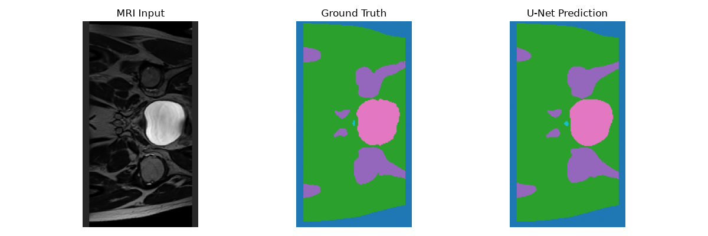 | 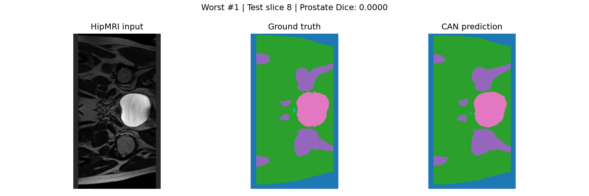 |

Observation: Both models reproduce the general anatomical structure of the image, including the bladder and surrounding tissue regions. However, the prostate occupies only a very small area adjacent to the bladder. CAN-128 achieves zero prostate overlap with the ground truth despite predicting the surrounding structures reasonably accurately. The U-Net also shows discrepancies in the small prostate region.

### Failure Case 2: Test Slice 93

| U-Net prediction | CAN-128 prediction |
|---|---|
| 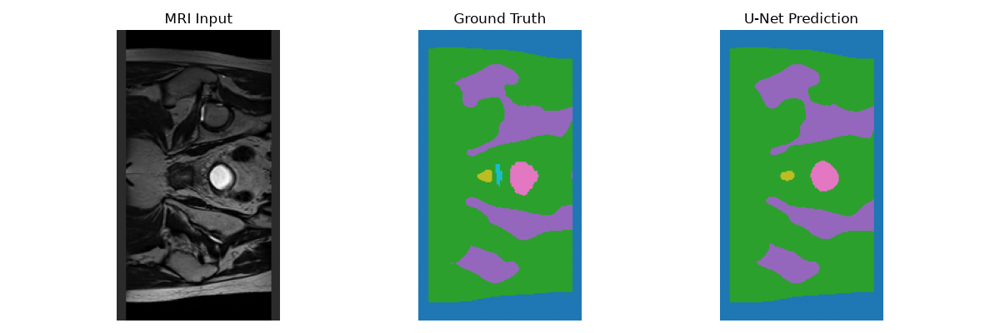 | 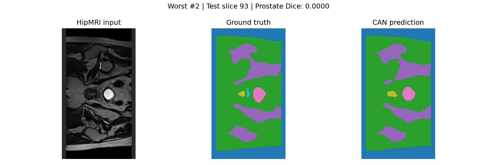 |

Observation: Both models successfully identify the larger anatomical regions, although differences in their predicted boundaries are visible. The ground-truth prostate is a narrow region beside the bladder. CAN-128 fails to reproduce this region with sufficient spatial overlap, resulting in a Dice score of zero. The U-Net prediction also differs from the ground truth around this small structure.

### Failure Case 3: Test Slice 130

| U-Net prediction | CAN-128 prediction |
|---|---|
| 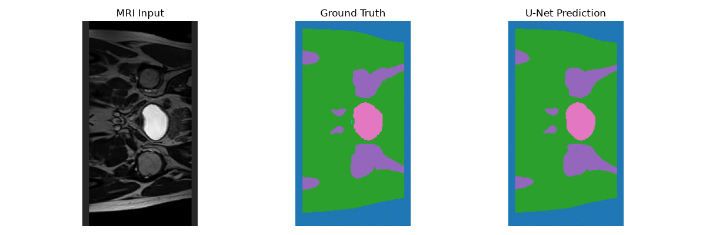 | 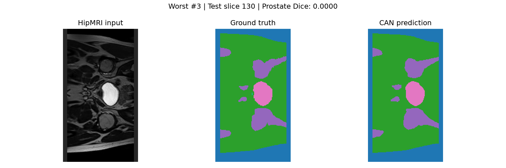 |

Observation: The predicted bladder and surrounding tissue regions closely resemble the ground truth for both models. However, the prostate is again represented by only a very small number of pixels. CAN-128 fails to achieve any overlap with the ground-truth prostate, while the U-Net prediction also shows inaccuracies in this region.

### Overall Failure Analysis

Across the three cases, a consistent pattern emerges: both architectures can reproduce the larger anatomical structures while struggling with the smaller prostate regions.

The CAN-128 model achieved a prostate Dice score of zero on all three selected slices, despite achieving an overall test prostate Dice of 0.8479. This shows that strong aggregate segmentation performance can conceal complete failures on individual images.

The U-Net demonstrates similar difficulties in these examples, although its overall test prostate Dice of 0.8495 and boundary F1 of 0.7084 are slightly higher than CAN-128's corresponding values of 0.8479 and 0.6886.

Three possible contributors to these failures are:

1. Small target size: Minor boundary or positional errors can eliminate the overlap between predicted and ground-truth prostate regions.
2. Class imbalance: The much larger surrounding anatomical classes dominate the image and may contribute disproportionately to the cross-entropy training objective.
3. Limited spatial information: The models operate on individual 2D slices without access to adjacent slices, which may make very small or ambiguous anatomical regions more difficult to identify.

The results indicate that neither model consistently segments every prostate slice correctly. Although CAN-128 approaches U-Net in overall Dice, the U-Net provides better average boundary accuracy and faster inference in the reported experiments.

Engineering implication: For applications requiring reliable anatomical boundaries, aggregate Dice alone is insufficient. Individual failure cases and boundary-specific metrics should also be considered. Future work should investigate class-balanced training and the incorporation of neighbouring MRI slices to improve robustness in challenging regions.

## 9. Discussion: Context, Boundaries and Efficiency

The experiments support three main observations:

1. Accuracy: All configurations exceeded the required prostate Dice threshold. U-Net achieved the highest aggregate prostate Dice and IoU. Increasing CAN feature width improved region overlap, especially moving from 32 to 128 channels.
2. Capacity and latency: CAN-128 nearly matched the U-Net's prostate Dice with fewer parameters, but it required substantially more training memory and inference time. CAN-32 gave the best measured latency and memory footprint but worse prostate overlap.
3. Boundary quality: The corrected class-5 results favour U-Net for mean prostate boundary precision and F1 at a two-pixel tolerance. CAN-128 comes closest on boundary F1 and has slightly higher recall, but it does not surpass U-Net overall. This supports a boundary-specific finding beyond region overlap, although *matched-slice failure autopsies and physical-distance validation** remain necessary before making clinical claims.

A plausible architectural explanation is that U-Net's downsampling creates a multi-resolution hierarchy, while encoder-to-decoder skips preserve finer detail. CAN has a broad theoretical receptive field without downsampling, but the lack of explicit multiresolution feature fusion may limit boundary accuracy.

### Limitations

- The model processes 2D slices independently, not full patient volumes.
- One recorded 20-epoch run per configuration.
- No data augmentation or class-weighted loss.
- Boundary measurements use a two-pixel threshold, not a physical millimetre distance.
- Parameter counts and runtime depend on implementation and hardware; the measured per-slice timing excludes preprocessing and data transfer.

## 10. Engineering Recommendation

For the current prototype, U-Net-32 is the strongest model when the priority is measured prostate segmentation quality: it produced the highest test prostate Dice (0.8495) and IoU (0.7384), and was faster than CAN-64 and CAN-128 in the recorded single-slice benchmark. For a tighter compute budget or higher throughput, CAN-32 is a reasonable alternative to evaluate further: it remains above the required prostate Dice threshold (0.8157) and offers the lowest parameter count, GPU usage and mean inference latency. CAN-128 is difficult to justify solely on the current aggregate overlap results, because it nearly matches U-Net accuracy but is much slower and more memory-intensive.

## 11. Feasibility Review

### User need, scope and acceptance criteria

The proposed system was a medical imaging segmentation tool to generate anatomical contours for review, with a focus on the prostate class. The key concern was whether high global segmentation overlap would translate into safe, accurate boundaries. Acceptance criteria were: (1) prostate test Dice ≥ 0.75; (2) comparison of CAN versus U-Net region and boundary accuracy; (3) three to five qualitative failures; and (4) memory and runtime feasibility.

### Proposed model and course concepts

The initial plan was to use the HipMRI 2D NIfTI slices, implement a PyTorch 2D U-Net baseline, then investigate a CAN based on dilated convolutions. Relevant course concepts included convolutional feature extraction, receptive fields, downsampling, upsampling, skip connections, multiclass classification and cross-entropy loss.

### Preliminary feasibility evidence

The dataset included 11,460 training, 660 validation and 540 test slices with six segmentation labels. MRI/mask alignment was to be enforced through paired loading. An early five-epoch test was reported as taking 433s, using 940.58 MiB peak GPU memory. The preliminary proposal contemplated training for 50 epochs if necessary. Actual completed comparisons instead used 20 epochs per model, based on the loss curves and available computing budget.

### Risks, computing budget and fallback

The initial risks were class imbalance, difficult tissue boundaries, varying MRI intensity, overfitting and patient leakage. Training resources available included Rangpur GPU access and a local NVIDIA GeForce RTX 3060 Ti. The fallback was a simpler or narrower network, with U-Net retained as a reliable baseline. The final four-model comparison evaluated the effect of increasing CAN channels and the resulting accuracy–cost trade-off.

## 12. Dependencies and Reproducibility

### Recorded software versions
| Dependency | Recorded version |
|---|---|
| Python | `3.14.7` |
| PyTorch | `2.14.0+cu126` |
| NumPy | `2.5.2` |
| NiBabel | `5.4.2` |
| Matplotlib | `3.11.2` |
| Pillow | `12.3.0` |
| tqdm | `4.70.1` |
| SciPy | `1.18.1` |

Exact dependency versions are specified in requirements.txt.
Install the required dependencies using:
python -m pip install -r requirements.txt
The models were trained and evaluated on an NVIDIA GeForce RTX 3060 Ti with CUDA 12.6 using Microsoft Windows 11 Home.

### Project files

```text
recognition/2D_CAN_s4801322/
├── config.py       # Paths, model widths and hyperparameters
├── dataset.py      # NIfTI loading, pairing, normalisation and padding
├── modules.py      # U-Net and CAN architectures
├── train.py        # Training, validation, checkpoint and loss plots
├── predict.py      # Held-out testing, boundary metrics, timing, worst cases
├── README.md       # This report
└── figures/        # Report figures
```

### How to run

1. Create a Python environment and install the pinned dependencies.
2. Edit the absolute dataset paths in `config.py` to point to your local `keras_slices_data` folders. Confirm all six labelled classes are present and correctly mapped.
3. Choose the architecture in both scripts (the supplied `train.py` and `predict.py` currently construct `CAN` models), and set the matching `BASE_CHANNELS` or `HIDDEN_CHANNELS` and unique checkpoint path.
4. Run `python train.py` to fit the selected model and save its lowest-validation-loss checkpoint and loss curve.
5. Run `python predict.py` with the same model architecture and its matching checkpoint to evaluate the held-out test set, benchmark per-slice latency, and save the worst-case figures.
6. Repeat using the remaining configurations while retaining their outputs separately. Do not use test scores to select training hyperparameters.

Important configuration check: The uploaded `config.py` currently points `MODEL_PATH` at `model.pth` and `LOSS_PLOT_PATH` at `loss_model.png`. Change these paths for each run to avoid mislabelled or overwritten outputs.

## 13. Artificial Intelligence Usage Disclosure

ChatGPT 6 was used to explain convolutional segmentation concepts and model structures, assist with debugging and creating Python evaluation functions, discuss Dice and boundary metrics, and help organise and draft the README report.

The AI code that was used was verified by checking model tensor dimensions, visually verifying image/mask alignment, reading through all code to verify the logic used and checking Dice/IoU calculations.

## 14. References

1. O. Ronneberger, P. Fischer, and T. Brox, “U-Net: Convolutional Networks for Biomedical Image Segmentation,” *MICCAI*, 2015. https://arxiv.org/abs/1505.04597
2. F. Yu and V. Koltun, “Multi-Scale Context Aggregation by Dilated Convolutions,” *ICLR*, 2016. https://arxiv.org/abs/1511.07122
3. The University of Queensland, COMP3710/COMP7710 Pattern Recognition — Project Report Specification (2026), supplied course PDF.
4. OpenAI. (2026). *ChatGPT* (GPT-6) [Large language model]. https://chatgpt.com/